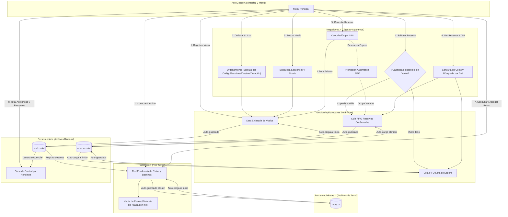

# ✈️ AeroGestión — Sistema de Gestión de Vuelos y Pasajeros

[](#)
[](#)
[](#)

> **AeroGestión** es un sistema desarrollado para **Algoritmos y Estructuras de Datos II (AED2)**. Su propósito es simular y optimizar la administración de vuelos, aerolíneas, pasajeros y rutas comerciales en un aeropuerto, aplicando estructuras de datos avanzadas, técnicas algorítmicas y persistencia de datos.

---

## Tabla de Contenidos

1. [Introducción](#introducción)
2. [Características Principales](#características-principales)
3. [Estructuras de Datos y Técnicas](#estructuras-de-datos-y-técnicas)
4. [Control de flujo](#control-de-flujo)
5. [Metodología de Trabajo](#metodología-de-trabajo)
6. [Instrucciones Básicas](#instrucciones-básicas)

---

## Introducción

El proyecto surge de la descomposición modular de la operativa diaria de un aeropuerto comercial. El objetivo es resolver la logística de asignación de vuelos, el control estricto del orden de llegada en la reserva de pasajes, el cálculo y consulta de rutas aéreas entre destinos, y el almacenamiento seguro de la información mediante archivos.

---

## Características Principales

- **Registro de Aerolíneas y Vuelos:** Gestión de código de vuelo alfanumérico, aerolínea operadora, destino, duración estimada y cupo máximo de pasajeros.
- **Gestión de Reservas y Cancelaciones:** Sistema de reservas en orden de llegada con control de aforo máximo, consulta por DNI y liberación automática de cupos ante cancelaciones.
- **Red de Conexiones Aéreas:** Modelado de conexiones entre aeropuertos con matrices de adyacencia, distancias en kilómetros y tiempos de vuelo.
- **Búsqueda y Ordenamiento Eficiente:** Búsqueda rápida de vuelos por código (secuencial y binaria) y ordenamiento multicriterio de itinerarios.
- **Persistencia de Datos y Reportes:** Almacenamiento y recuperación en archivos binarios (`.dat`) y de texto (`.txt`), además de informe agrupado por aerolínea mediante corte de control.

---

## Estructuras de Datos y Técnicas

| Componente / Estructura | Aplicación en el Proyecto | Justificación de Diseño |
| :--- | :--- | :--- |
| **Listas Enlazadas** | Registro de vuelos y aerolíneas | Permiten un manejo dinámico y flexible de registros sin tamaño fijo previo en memoria. |
| **Colas (FIFO)** | Sistema de reservas de pasajeros | Garantizan equidad procesando las solicitudes estrictamente por orden de llegada. |
| **Red de Rutas (Ponderada)** | Red de aeropuertos y rutas (`tRedRutas`) | Los nodos representan aeropuertos/destinos y las aristas almacenan distancias (km) y tiempos de viaje. |
| **Algoritmos de Búsqueda** | Búsqueda por código de vuelo y DNI | Localización rápida y precisa de vuelos (secuencial/binaria) y pasajeros dentro del sistema. |
| **Algoritmos de Ordenamiento** | Listados de vuelos y destinos | Organización burbuja de los vuelos según código, aerolínea, destino o duración. |
| **TADs (Tipos Abstractos)** | Modelado de Entidades | Modularización y encapsulamiento del comportamiento de vuelos, reservas, negocio, rutas y persistencia. |
| **Persistencia Binaria (.dat)** | `vuelos.dat` y `reservas.dat` | Almacenamiento confiable de vuelos y reservas al iniciar y modificar datos. |
| **Persistencia de Texto (.txt)** | `rutas.txt` (`PersistenciaRutas.h`) | Configuración e inspección externa de rutas y distancias entre aeropuertos en texto plano delimitado por `;`. |
| **Corte de Control** | Informe de aerolíneas y pasajeros | Procesamiento secuencial en un solo paso sobre `vuelos.dat` ordenado por aerolínea. |

---

## Control de flujo



---

## Metodología de Trabajo

* **Programación de a Pares (Pair Programming):** Desarrollo colaborativo continuo para maximizar la calidad del código, el diseño de algoritmos y la detección temprana de errores.
* **Descomposición Modular:** Abordaje sistemático de subproblemas individuales hacia la integración del sistema global (`Gestion.h`, `topologia.h`, `Negocioyop.h`, `PersistenciaRutas.h`, `Persistencia.h` y `AeroGestion.c`).
* **Reflexión y Aprendizaje:** Documentación de decisiones técnicas y lecciones aprendidas a lo largo de las distintas etapas de la asignatura.

---

## Instrucciones Básicas

### Prerrequisitos
* Compilador / Entorno de desarrollo acorde al lenguaje del proyecto (ej. GCC / MinGW / DevC++ / Visual Studio para C).

### Ejecución
1. Clonar o descargar el repositorio:
   ```bash
   git clone https://github.com/dvn2200/AeroGestion.git
   cd AeroGestion
   ```
2. Compilar el proyecto:
   ```bash
   gcc -Wall -Wextra AeroGestion.c -o output/AeroGestion.exe
   ```
3. Ejecutar el binario generado y seguir las opciones del menú interactivo para:
   - Cargar, ordenar y consultar vuelos.
   - Solicitar, consultar por DNI y cancelar reservas.
   - Consultar la red de aeropuertos y conexiones disponibles (`rutas.txt`).
   - Emitir el reporte agrupado de aerolíneas y pasajeros (`vuelos.dat`).

---

> [!NOTE]
> Proyecto integrador para **Algoritmos y Estructuras de Datos II**.
