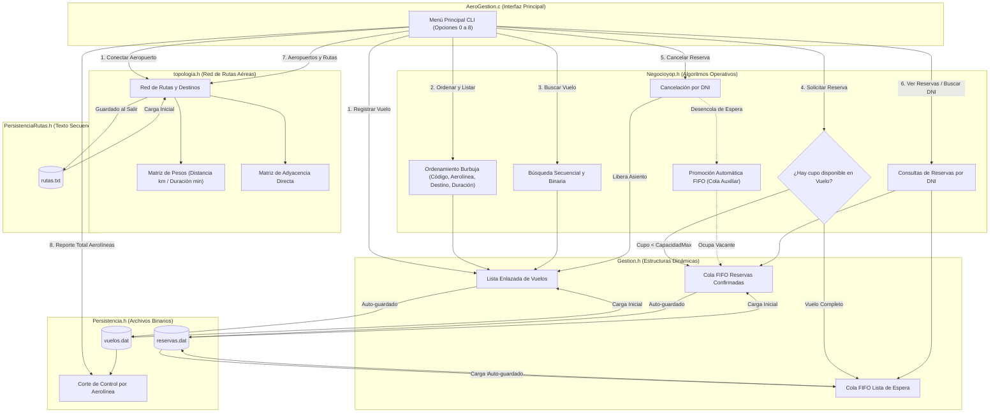

# ✈️ AeroGestión — Sistema de Gestión de Vuelos y Pasajeros

[](#)
[](#)
[](#)

> **AeroGestión** es un sistema integral desarrollado para la cátedra de **Algoritmos y Estructuras de Datos II (AED2)**. Su propósito es simular, administrar y optimizar la operativa comercial de un aeropuerto: control de vuelos, asignación equitativa de pasajes mediante colas de espera, modelado de la red vial aérea con matrices de pesos y adyacencia, y persistencia mixta (binaria y texto) con reportes basados en corte de control.

---

## 📌 Tabla de Contenidos

1. [Introducción](#-introducción)
2. [Características Principales](#-características-principales)
3. [Estructuras de Datos y Técnicas](#-estructuras-de-datos-y-técnicas)
4. [Módulos del Sistema](#-módulos-del-sistema)
5. [Arquitectura y Flujo de Control](#-arquitectura-y-flujo-de-control)
6. [Persistencia de Datos](#-persistencia-de-datos)
7. [Metodología de Trabajo](#-metodología-de-trabajo)
8. [Instrucciones de Compilación y Ejecución](#-instrucciones-de-compilación-y-ejecución)

---

## 🛫 Introducción

El sistema surge a partir de la descomposición modular de la operativa diaria de un aeropuerto comercial. Resuelve:
- La logística de asignación de itinerarios y aforos máximos de aeronaves.
- El orden estricto de llegada para la asignación de asientos o listas de espera mediante colas FIFO.
- La reasignación automática de vacantes ante cancelaciones de pasajes respetando la prioridad.
- La topología de la red aérea comercial (distancias y duraciones entre aeropuertos).
- El resguardo persistente en disco del estado del sistema en archivos binarios y de texto plano.

---

## ⚙️ Características Principales

- **Registro de Vuelos y Destinos:** Asignación de código alfanumérico (ej. `AR34`), aerolínea operadora, destino, duración de vuelo y capacidad máxima.
- **Gestión de Reservas y Cancelaciones:** Asignación a reservas confirmadas o colas de espera según capacidad; cancelación por DNI con promoción automática del primer pasajero en espera (FIFO) mediante cola auxiliar.
- **Consultas y Reportes por Pasajero:** Visualización de colas completas (confirmadas y en espera) y búsqueda por DNI.
- **Red de Rutas Aéreas:** Representación matricial fija de aeropuertos comerciales con matrices de pesos (distancia en km y duración en min) y adyacencia.
- **Búsqueda y Ordenamiento Multicriterio:** Búsqueda secuencial y binaria; ordenamiento burbuja por código de vuelo, aerolínea, destino o duración estimada.
- **Persistencia Mixta y Corte de Control:** Almacenamiento binario (`.dat`) para vuelos y reservas, almacenamiento en texto (`.txt`) para rutas aéreas, y reporte estadístico agrupado con técnica de corte de control por aerolínea.

---

## 📊 Estructuras de Datos y Técnicas

| Componente / Técnica | Aplicación en el Proyecto | Justificación de Diseño |
| :--- | :--- | :--- |
| **Listas Enlazadas Simples** | Registro dinámico de vuelos (`tNodoVuelo`) | Crecimiento dinámico en memoria RAM sin necesidad de aforos fijos previos. |
| **Colas Dinámicas (FIFO)** | Reservas confirmadas y lista de espera (`tColaReservas`) | Garantizan estricta equidad por orden de llegada (First-In, First-Out). |
| **Cola Auxiliar** | Cancelación y extracción de reservas | Permite extraer un elemento intermedio manteniendo el orden relativo de los demás nodos. |
| **Red de Rutas (Matricial)** | Conexiones entre aeropuertos (`tRedRutas`) | Matriz de pesos (distancia km, duración min) y matriz de adyacencia directa entre nodos. |
| **Algoritmos de Ordenamiento** | Ordenamiento burbuja multicriterio | Permite reordenar el itinerario por código, aerolínea, destino o duración. |
| **Algoritmos de Búsqueda** | Búsqueda secuencial y binaria | Búsqueda binaria sobre vector dinámico indexado para localización rápida de vuelos. |
| **Persistencia Binaria (`.dat`)** | `vuelos.dat` y `reservas.dat` | Serialización directa de registros homogéneos de longitud fija (`sizeof`). |
| **Persistencia de Texto (`.txt`)** | `rutas.txt` | Formato editable y legible externamente delimitado por `;` para la red de conexiones. |
| **Corte de Control** | Informe estadístico de aerolíneas | Procesamiento secuencial en un solo paso aprovechando el ordenamiento previo por clave. |

---

## 🧩 Módulos del Sistema

El proyecto se encuentra modularizado en archivos de cabecera (`.h`) con responsabilidades delimitadas:

1. **`Gestion.h` (TADs Dinámicos Primitivos):**
   - Declara tipos de datos base (`sstring`, `tVuelo`, `tNodoVuelo`, `tReserva`, `tNodoReserva`, `tColaReservas`).
   - Implementa operaciones primitivas: `inicializar()`, `insertarVuelo()`, `mostrarVuelos()`, `liberarListaVuelos()`, `encolarReserva()`, `desencolarReserva()`, `mostrarColaReservas()`, `liberarCola()`.
2. **`topologia.h` (Red Vial Aérea):**
   - Modela vértices (aeropuertos) y aristas (rutas con peso: km y minutos) mediante matrices bidimensionales.
   - Funciones: `inicializarRedRutas()`, `existeAeropuerto()`, `existeRuta()`, `agregarAeropuerto()`, `agregarRuta()`, `maximoAeropuerto()`, `mostrarMatrizPesos()`, `mostrarMatrizAdyacencia()`, `mostrarConexiones()`, `cargarRutaManual()`, `menuDeRutas()`.
3. **`Negocioyop.h` (Lógica de Negocio y Algoritmos):**
   - Coordina los servicios operativos: búsqueda por código, búsqueda binaria, ordenamiento burbuja multicriterio, solicitud de reserva con asignación condicional, cancelación con promoción de espera, consultas por DNI y menús secundarios.
4. **`PersistenciaRutas.h` (Persistencia en Texto de Rutas):**
   - `cargarRutasTexto()`: Lee conexiones aéreas desde `rutas.txt` al iniciar el programa.
   - `guardarRutasTexto()`: Guarda las conexiones y ponderaciones activas en `rutas.txt` al cerrar el sistema.
5. **`Persistencia.h` (Persistencia Binaria y Reportes):**
   - `guardarDatosBinarios()`: Serializa vuelos en `vuelos.dat` y reservas en `reservas.dat`.
   - `cargarDatosBinarios()`: Recupera el estado binario persistido en memoria.
   - `corteDeControlAerolineas()`: Emite informe consolidado de aerolíneas, vuelos y pasajeros aplicando corte de control.
6. **`AeroGestion.c` (Punto de Entrada y Menú CLI):**
   - Función `main()`: Configuración de consola UTF-8, carga secuencial de datos, ejecución del menú principal coordinado y liberación controlada de memoria dinámica.

---

## 🔄 Arquitectura y Flujo de Control



---

## 💾 Persistencia de Datos

El sistema implementa dos esquemas complementarios de almacenamiento:

### 1. Archivos Binarios (`.dat`)
- **`vuelos.dat`**: Almacena secuencialmente registros homogéneos de tipo `tVuelo`. Permite el procesamiento directo con `sizeof(tVuelo)` y sirve de fuente para el algoritmo de corte de control.
- **`reservas.dat`**: Almacena secuencialmente registros de tipo `tReserva`, identificando si la reserva está confirmada o en espera mediante un campo booleano (`confirmada`).

### 2. Archivo de Texto Plano (`rutas.txt`)
- Estructurado por líneas delimitadas por punto y coma (`;`), ignorando comentarios que inician con `#`:
  ```text
  # OrigenID;OrigenNombre;DestinoID;DestinoNombre;DistanciaKm;DuracionMin
  0;Aeroparque;1;Cordoba;695;85
  0;Aeroparque;2;Mendoza;985;115
  0;Aeroparque;3;Bariloche;1350;130
  1;Cordoba;3;Bariloche;1240;120
  ```

---

## 👥 Metodología de Trabajo

* **Programación de a Pares (Pair Programming):** Desarrollo colaborativo continuo para maximizar la calidad del código, el diseño de algoritmos y la detección temprana de errores.
* **Descomposición Modular:** Separación estricta entre definición de TADs primitivos, lógica de negocio y persistencia en disco.
* **Manejo Responsable de Recursos:** Liberación completa de listas y colas en memoria dinámica al finalizar la ejecución para prevenir fugas de memoria (*memory leaks*).

---

## 🛠️ Instrucciones de Compilación y Ejecución

### Prerrequisitos
* Compilador de C compatible con estándares C99 o C11 (ej. **GCC / MinGW**).
* Consola de Windows (soporta UTF-8 mediante `chcp 65001`).

### Compilación desde Terminal
Posicionarse en el directorio raíz del proyecto y ejecutar:

```powershell
gcc -Wall -Wextra AeroGestion.c -o output/AeroGestion.exe
```

### Ejecución
```powershell
./output/AeroGestion.exe
```

---

> [!NOTE]
> Trabajo Práctico Integrador para la materia **Algoritmos y Estructuras de Datos II**.
