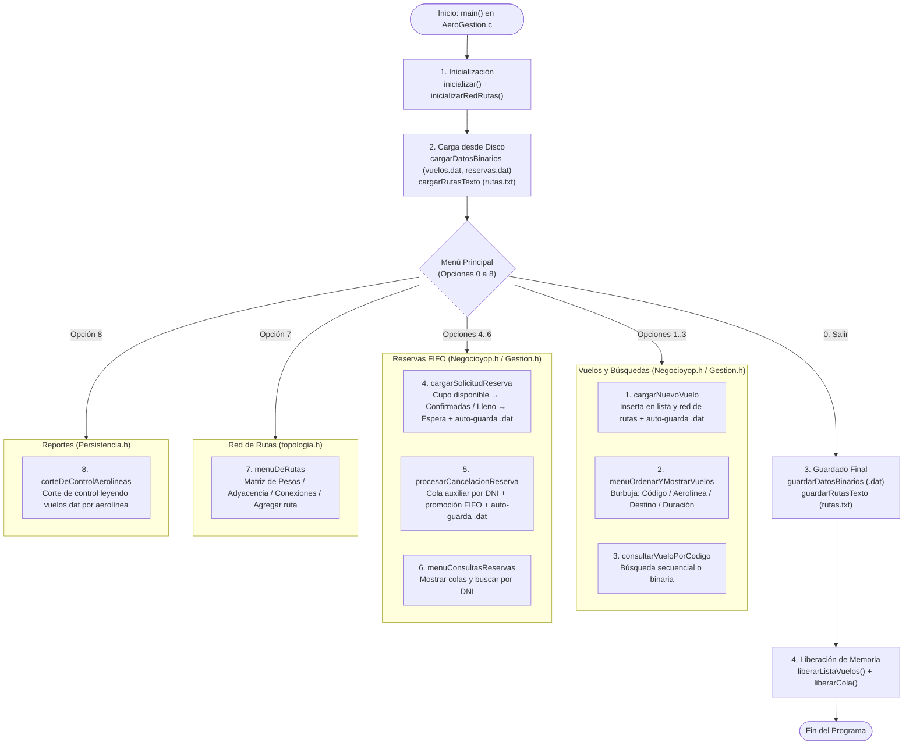

# ✈️ AeroGestión — Sistema de Gestión de Vuelos y Pasajeros

[](#)
[](#)
[](#)

> **AeroGestión** es un sistema desarrollado en C para **Algoritmos y Estructuras de Datos II (AED2)**. Simula y administra la operativa de un aeropuerto comercial: gestión de vuelos, reservas con cola de espera FIFO, red ponderada de rutas entre aeropuertos, algoritmos de búsqueda y ordenamiento, persistencia mixta (`.dat` y `.txt`) e informes por corte de control.

---

## Tabla de Contenidos

1. [Introducción](#introducción)
2. [Características Principales](#características-principales)
3. [Estructuras de Datos y Técnicas](#estructuras-de-datos-y-técnicas)
4. [Arquitectura y Flujo del Sistema](#arquitectura-y-flujo-del-sistema)
5. [Metodología de Trabajo](#metodología-de-trabajo)
6. [Instrucciones Básicas](#instrucciones-básicas)

---

## Introducción

El proyecto surge de la descomposición modular de la operativa diaria de un aeropuerto comercial. Resuelve la administración dinámica de vuelos, el respeto estricto al orden de llegada en la reserva de pasajes (incluyendo liberación y promoción automática ante cancelaciones), el registro de conexiones aéreas con distancias y duraciones, y la persistencia automática de la información entre ejecuciones.

---

## Características Principales

- **Gestión de Vuelos:** Registro de vuelos con código alfanumérico (ej. `AR34`), aerolínea, aeropuerto origen/destino, duración estimada y capacidad máxima.
- **Reservas (FIFO) y Cancelaciones:** Asignación automática a cola de confirmadas o cola de espera según disponibilidad. Ante una cancelación por DNI, se extrae el registro mediante cola auxiliar y se promueve al primer pasajero en espera para ese vuelo.
- **Consulta de Colas y Pasajeros:** Visualización completa de reservas confirmadas/en espera y búsqueda de reservas activas por DNI.
- **Red de Aeropuertos y Rutas:** Modelado matricial de hasta 15 aeropuertos (`tRedRutas`), con matriz de adyacencia, matriz de pesos (distancia en km y duración en minutos) y consulta de conexiones directas.
- **Búsqueda y Ordenamiento:** Ordenamiento burbuja multicriterio (código, aerolínea, destino o duración), búsqueda secuencial y búsqueda binaria sobre vector dinámico ordenado.
- **Persistencia Mixta y Corte de Control:** Guardado automático en archivos binarios (`vuelos.dat`, `reservas.dat`), persistencia de la red de rutas en texto plano (`rutas.txt`) y reporte agrupado por aerolínea mediante corte de control.

---

## Estructuras de Datos y Técnicas

| Componente / Estructura | Implementación en el Código | Propósito y Diseño |
| :--- | :--- | :--- |
| **Lista Enlazada Simple** | `tNodoVuelo` (`Gestion.h`) | Almacena dinámicamente el catálogo de vuelos sin límite fijo en memoria. |
| **Colas Dinámicas (FIFO)** | `tColaReservas` (`Gestion.h`) | Gestiona reservas confirmadas y lista de espera respetando el orden de llegada. |
| **Cola Auxiliar** | `extraerReservaDeCola` (`Negocioyop.h`) | Extrae una reserva por DNI y código de vuelo preservando el orden FIFO restante. |
| **Red de Rutas (Matricial)** | `tRedRutas` (`topologia.h`) | Matriz de adyacencia y pesos (`distanciaKm`, `duracionMin`) bidireccional para hasta `N = 15` aeropuertos. |
| **Ordenamiento Burbuja** | `ordenarVuelos` (`Negocioyop.h`) | Reordena la lista enlazada según criterio: código, aerolínea, destino o duración. |
| **Búsqueda Secuencial y Binaria** | `buscarVueloPorCodigo` / `busquedaBinariaVuelo` | Localización directa en lista o mediante arreglo dinámico temporal indexado. |
| **Persistencia Binaria (`.dat`)** | `Persistencia.h` (`vuelos.dat`, `reservas.dat`) | Almacena vuelos ordenados por aerolínea y colas de reservas al modificar datos y al salir. |
| **Persistencia de Texto (`.txt`)** | `PersistenciaRutas.h` (`rutas.txt`) | Lee al inicio y guarda al salir las rutas en formato legible delimitado por `;`. |
| **Corte de Control** | `corteDeControlAerolineas` (`Persistencia.h`) | Procesa `vuelos.dat` secuencialmente para totalizar vuelos y pasajeros por aerolínea. |

---

## Arquitectura y Flujo del Sistema

El sistema sigue una arquitectura modular en capas donde cada cabecera encapsula una responsabilidad específica (`AeroGestion.c` → `Persistencia.h` → `PersistenciaRutas.h` → `Negocioyop.h` → `topologia.h` → `Gestion.h`):



---

## Metodología de Trabajo

* **Programación de a Pares (Pair Programming):** Desarrollo colaborativo continuo para maximizar la calidad del código, el diseño de algoritmos y la detección temprana de errores.
* **Descomposición Modular:** Separación en TADs primitivos (`Gestion.h`), topología de rutas (`topologia.h`), lógica operativa (`Negocioyop.h`) y persistencia desacoplada para datos binarios (`Persistencia.h`) y texto (`PersistenciaRutas.h`).
* **Gestión de Memoria Dinámica:** Reserva dinámica controlada y liberación completa de nodos de listas y colas al finalizar la ejecución.

---

## Instrucciones Básicas

### Prerrequisitos
* Compilador de C estándar (GCC / MinGW / Dev-C++).

### Ejecución
1. Clonar o descargar el repositorio:
   ```bash
   git clone https://github.com/dvn2200/AeroGestion.git
   cd AeroGestion
   ```
2. Compilar el proyecto:
   ```bash
   gcc -Wall -Wextra AeroGestion.c -o output/AeroGestion.exe
   ```
3. Ejecutar el binario (`./output/AeroGestion.exe`) y utilizar el menú interactivo para:
   - Registrar, ordenar y buscar vuelos (opciones `1` a `3`).
   - Solicitar, cancelar y consultar reservas por DNI (opciones `4` a `6`).
   - Consultar matrices y agregar rutas aéreas guardadas en `rutas.txt` (opción `7`).
   - Emitir el reporte de totales por aerolínea desde `vuelos.dat` (opción `8`).

---

> [!NOTE]
> Proyecto integrador para **Algoritmos y Estructuras de Datos II**.
